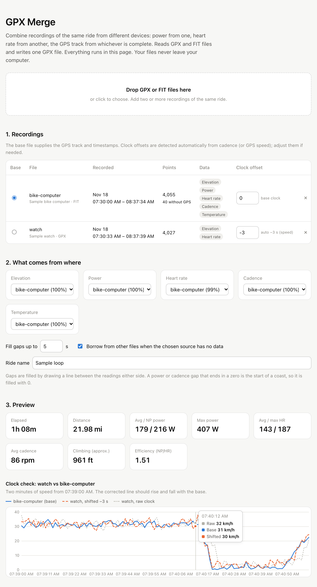

# GPX Merge

A small browser app for merging GPX and FIT recordings of the same ride from different devices: power from a bike computer, heart rate from a watch, the GPS track from whichever recording is complete. The result is one GPX file to upload to Strava (or anywhere else).

**[Open GPX Merge](https://andydetskas.github.io/gpx-merge/)**

Everything runs in the page. Files are read locally and never uploaded. There is no build step and no dependencies.

<picture>
  <source media="(prefers-color-scheme: dark)" srcset="docs/screenshot-dark.png">
  
</picture>

## Use it

- **Online:** [andydetskas.github.io/gpx-merge](https://andydetskas.github.io/gpx-merge/). No files handy? Click **Load two sample recordings** to see it work on a made-up ride.
- **Locally:** download or clone the repo and open `index.html`. Opening it straight from disk works fine.

Drop in two or more GPX or FIT files, check the preview, and click **Download merged GPX**.

Getting the files: most bike computers and watches can export the original FIT file, and Strava can export GPX or the original upload from an activity's menu. Garmin Connect's *Export Original* gives a `.zip`; unzip it first. The `.fit.gz` and `.gpx.gz` files in a Strava bulk export can be added as they are.

## How the merge works

1. **Base file.** By default this is the recording that has power and GPS (or the one with the most GPS points). It supplies the GPS track and timestamps. You can change it.
2. **Clock alignment.** Device clocks drift by a few seconds. The app slides each file against the base, ±30 s, and picks the shift where cadence lines up best, or GPS speed if a file has no cadence. You can see the result in the "clock check" chart and change the offset by hand.
3. **Channels.** Elevation, power, heart rate, cadence and temperature are each taken from one file you choose. The default is whichever file covers the most of the ride.
4. **Short gaps** (5 s or less by default) are filled by drawing a line between the readings either side. A power or cadence gap that ends in a zero is the start of a coast, so it is filled with 0 rather than a made-up ramp.
5. **Longer gaps.** If a channel's chosen file has nothing for a stretch, for example because a sensor dropped out, the app borrows readings from another file that has them. If the base file has no GPS for a stretch, points from the other files are added to the track, with elevation adjusted to match. You can turn this off.
6. **Readings without GPS.** FIT files can hold seconds with power or heart rate but no position, before the first fix or in a tunnel. Those readings are still used, but never become track points, since GPX needs a position for every point.
7. **Output.** GPX 1.1 with `<power>` and the Garmin `TrackPointExtension` fields for heart rate, cadence and temperature, the same layout Strava exports. When the base is a GPX file, its GPS, elevation and timestamps are copied exactly as recorded.

## Files

```
index.html          page
css/style.css       styles (light and dark)
js/fit.js           FIT decoder for the messages the merge needs, and a small encoder
js/gpx.js           parsing, alignment, merging, GPX writing
js/plot.js          small canvas line chart
js/app.js           UI
js/sample.js        synthetic sample rides (demo button and tests)
test/               tests
```

`js/fit.js`, `js/gpx.js` and `js/sample.js` have no browser dependencies, so you can script them in Node:

```js
const fs = require('fs');
const G = require('./js/gpx.js');
const files = ['computer.fit', 'watch.gpx'].map(path => G.parseFile(fs.readFileSync(path), path));
const plan = G.autoPlan(files);
fs.writeFileSync('merged.gpx', G.writeGPX(G.merge(files, plan), { name: plan.name }));
```

## Tests

```
node --test
```

Needs Node 18 or later and nothing else. The tests use synthetic rides from `js/sample.js`, never real GPS tracks. They cover FIT decoding (compressed timestamps, big-endian and developer fields, unfinished and chained files), GPX parsing, clock alignment, gap filling, borrowing, and GPX output read back in. The FIT decoder and encoder were also checked against Garmin's FIT SDK.

## Limits

- Writes GPX only. Laps, and FIT developer fields such as running power or core temperature, aren't carried over.
- At least one recording needs GPS. Indoor rides with no position can't be merged yet, because GPX can't hold them.
- TCX files aren't read.
- Assumes one-second recording, or close to it. "Smart recording" files work, but with fewer points to compare when lining up clocks.
- Strava recalculates moving time and climbing itself, so those may differ a little from the preview.

## Privacy note

GPX and FIT files contain exact GPS tracks, often starting at your front door. `.gitignore` excludes `*.gpx`, `*.fit` and `*.tcx`, plus the `.gz` and `.zip` exports they come in, so ride files aren't committed by accident.

## License

[MIT](LICENSE)
